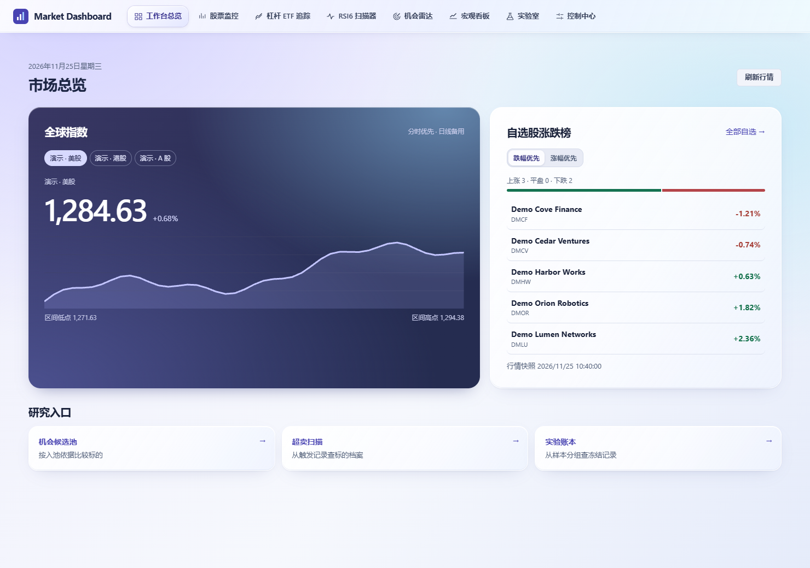
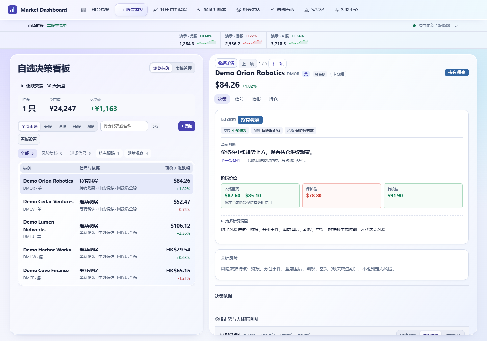
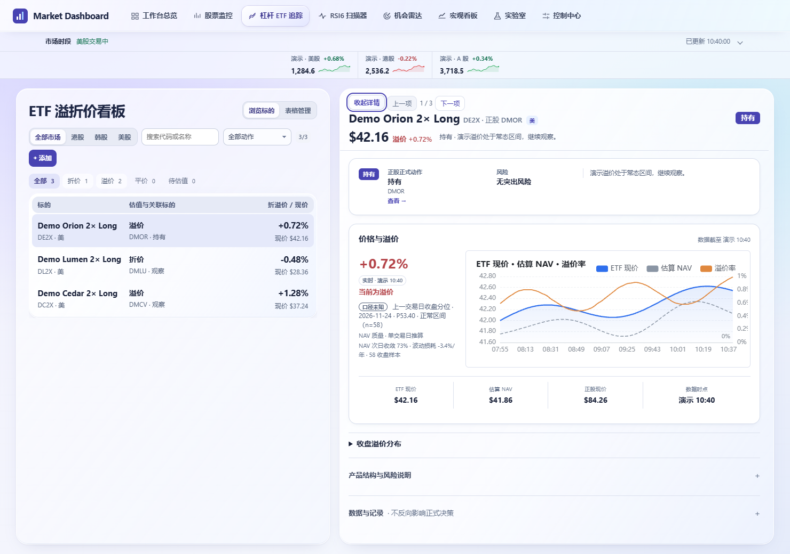
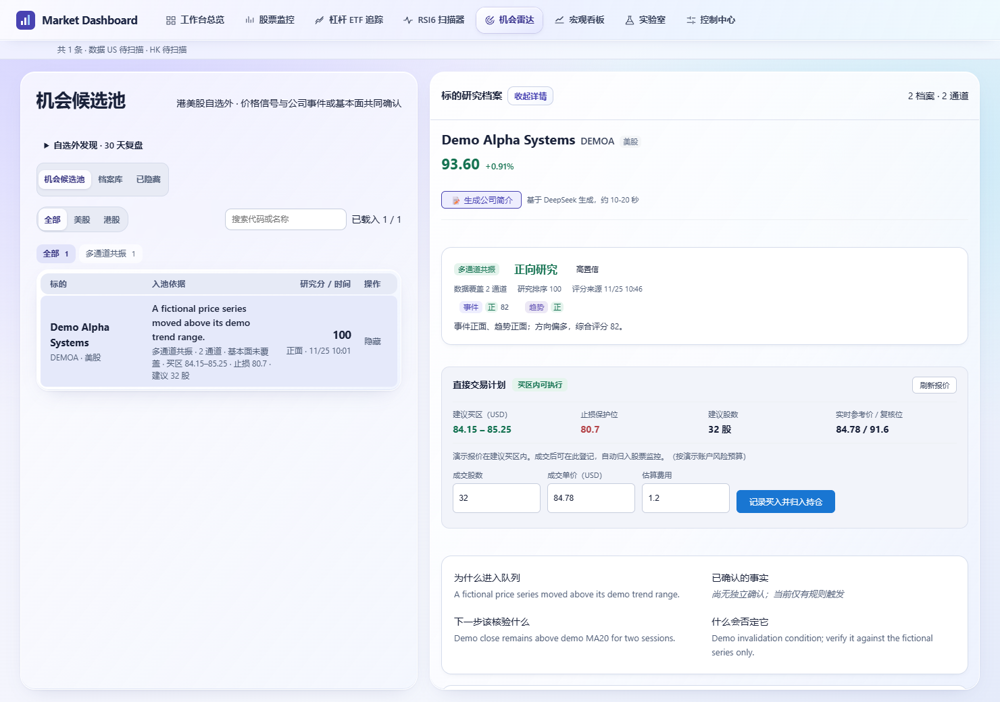

# Market Dashboard

Market Dashboard 是一个本地运行的市场研究看板，把港美股自选、持仓、2 倍杠杆 ETF、机会雷达和市场环境放在同一工作台。行情分析与研究记录保存在本机 SQLite，交易在你自己的券商完成。

## 2026-11-25 更新

- **股票监控**结合大盘状态、中线强势与短线回踩筛选港美普通股。实时价格进入当日买区且风险预算允许时，才给出可执行的买入提示。盘面走弱时可以空仓等待。
- **机会雷达**为符合条件的自选外港美普通股展示建议买区、止损保护位与建议股数。手动成交后，在雷达登记买入即可同步到股票自选和持仓。
- **30 天复盘**在股票页跟踪模拟组合，在雷达页跟踪候选发现后的表现。两页使用同期大盘（美股 SPY、港股 02800）和期初自选等权组合做对照。
- **工作台改版**统一各看板导航。宽屏可同时查看列表与详情，手机可在列表与详情之间切换。

## 快速开始

安装 [.nvmrc](.nvmrc) 指定的 Node.js 版本，在源码目录运行。

```sh
npm ci
npm start
```

打开 <http://127.0.0.1:8080>。Windows 上也可以在源码目录双击 `Start-Market-Dashboard.cmd`。首次启动会创建本地数据库，定时采集、告警和 LLM 后台任务默认关闭。数据源与运行参数见[本地配置说明](docs/open-source-setup.md)。

在全新测试目录中可用虚构雷达样本体验候选和档案页面，步骤见[使用说明](docs/user-guide.md)。

后端源码在 `src/`，页面资源在 `app/`，RSI6 扫描器在 `rsi6/`，启动和维护脚本在 `scripts/`。运行数据仍保存在项目根目录的 `data/`。

## 看板

| 页面 | 用途 |
| --- | --- |
| 市场工作台 `/` | 全球指数、市场概览和自选涨跌分布 |
| 股票监控 `/stock` | 自选与持仓、日 K 决策、成交登记与信号复盘 |
| 杠杆 ETF 追踪 `/tracker` | 2 倍杠杆 ETF 的正股方向、溢折价、NAV 与执行风险 |
| RSI6 `/assets/rsi6.html` | 港美股超卖筛选与事件记录 |
| 机会雷达 `/radar` | 自选外机会、研究档案、交易计划与发现复盘 |
| 宏观 `/macro` | 期权压力、市场广度、信用资金与三地波幅 |
| 实验室 `/lab` | 历史回放、影子样本、信号漂移与验证 |
| 控制中心 `/control` | 通知、调度、数据源状态和审计 |

## 演示截图

截图来自本次更新的本地页面，标的、报价和持仓均为虚构演示数据。

### 市场工作台



### 股票监控



[查看 30 天复盘截图](docs/images/stock-review.png)

### 杠杆 ETF 追踪



### 机会雷达



[查看研究档案截图](docs/images/radar-archive.png)

## 文档

- [使用说明](docs/user-guide.md)
- [本地配置和数据源](docs/open-source-setup.md)
- [决策系统与风险边界](docs/decision-system.md)
- [架构边界](docs/architecture-boundaries.md)
- [常见问题](docs/faq.md)
- [MIT 许可证](LICENSE)
